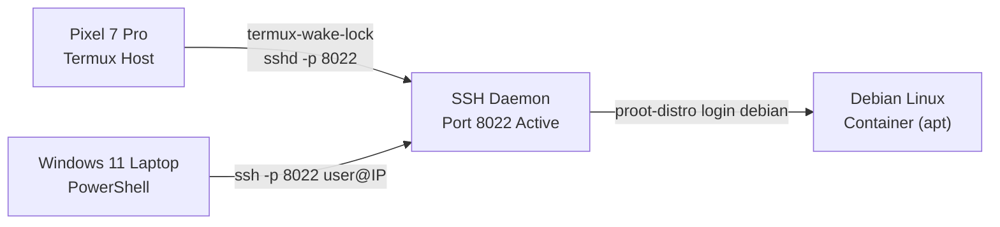

# NEXUS Owner Playbook

**Version:** 0.9.0  
**Target User:** Designer & System Owner (Pixel 7 Pro + Windows 11 + Termux + Debian proot)  
**Read Time:** ~5 minutes  

---

## 1. What is NEXUS?

NEXUS is your **personal technical memory vault and intelligent assistant**. 

Instead of searching through messy notes, old chat history, or confusing terminal logs, NEXUS keeps all your verified commands, device boundaries, troubleshooting steps, and workflows organized right on your phone — **100% offline, private, and secure**.

---

## 2. Installing NEXUS on Your Google Pixel 7 Pro (2 Minutes)

You don't need the Google Play Store or developer tools to install NEXUS.

### Step-by-Step Installation:
1. **Download the APK:**
   - Grab `app-debug.apk` (or `release/nexus-v0.9.0.apk` in this repository).
   - Transfer it to your Pixel 7 Pro via USB cable, Google Drive, or local file sharing.
2. **Open the File:**
   - Open the **Files by Google** app (or any file manager) on your phone.
   - Tap on `app-debug.apk`.
3. **Allow Installation (One-Time Prompt):**
   - Android will ask: *"For your security, your phone is not allowed to install unknown apps from this source."*
   - Tap **Settings** → toggle **Allow from this source** ON.
4. **Install & Launch:**
   - Tap **Install**. Once finished, tap **Open**.
   - NEXUS will launch with its dark Material 3 interface and immediately seed your personal starter catalog.

---

## 3. How to Use NEXUS Every Day (The 4 Tabs)

### Tab 1: Recall (Instant Search & Verification)
* **⭐ Pinned Daily Fast-Track:** Right at the top of your screen, your top 4 daily routines (Start SSH + wake lock, check Wi-Fi IP, connect from Windows, and start local Python server) are ready for 1-tap copying without typing anything!
* **Open Termux Shortcut:** Tap the **Open Termux** button at the top to immediately switch directly into the Termux app on your phone.
* **Instant Shell Filter:** Tap the filter chips at the top (**Termux**, **Debian proot**, or **Windows PowerShell**) to only see commands for that specific shell. You'll never accidentally run a Debian command inside Termux again.
* **Instant Search:** Type any keyword (e.g. `ssh`, `port 8022`, `python`, `git`, `ram`, `clean`).
* **One-Tap Copy:** Tap the **Copy Command** button on any card. A toast will confirm what shell and device it is meant for.
* **Verify Your Setup:** If a command worked for you, tap **Mark as Verified** to turn its badge green (`Verified on Your Setup`).

### Tab 2: Library (Step-by-Step Guides & Custom Notes)
* **Interactive Checklist:** Follow multi-step procedures (like *Setting Up Termux OpenSSH on Port 8022*). Check off each step as you complete it — your progress is automatically saved even if you close the app.
* **Add New Commands:** Tap **Add Recipe** to save your own commands.
* **Secret Guard Live Protection:** If you accidentally paste a password, SSH private key, or API token into a note, NEXUS will highlight it in red and block saving until the secret is removed.

### Tab 3: Troubleshoot & Grounded AI Assistant
* **Proven Error Fixes:** Browse common issues (like *SSH Connection Timed Out*, *Command Not Found: apt*, or *Host Key Verification Failed*). Each card gives you a safe read-only check and a verified fix.
* **Grounded Technical Assistant:**
  - Enter your issue or paste a terminal error message.
  - Tap **Preview Context** to see exactly what the assistant will inspect (all secrets are automatically scrubbed).
  - Tap **Diagnose Safe Fix**: NEXUS will look through your own saved notes and verified solutions to give you a plain-English explanation, target shell badge, and copyable command with direct citations.
  - **High-Risk Command Radar:** If a command could delete files (`rm -rf /`) or reformat drives, NEXUS shows a prominent red caution banner.

### Tab 4: Systems & Backup
* **Device & Environment Profiles:** Review filesystem rules, package managers (`pkg` for Termux vs `apt` for Debian), and pitfall warnings.
* **One-Tap Export:** Tap **Export JSON** or **Export Markdown** to copy your entire technical memory vault to the clipboard. Paste it into an email, GitHub gist, or Google Keep as an instant backup.
* **One-Tap Restore:** Tap **Restore from Backup JSON**, paste your saved JSON, and tap **Scan with Secret Guard & Restore**. NEXUS scans for sensitive leaks and restores all your recipes and troubleshooting history.

---

## 4. Your Daily 5-Minute SSH Workflow Cheat-Sheet

Here is the exact procedure NEXUS was built to streamline:



1. **On your Pixel 7 Pro (Termux Host):**
   ```bash
   termux-wake-lock && sshd -p 8022
   ```
   *(Keeps phone CPU awake and starts SSH on port 8022)*

2. **On your Windows 11 Laptop (PowerShell):**
   ```powershell
   ssh -p 8022 <PHONE_WIFI_IP>
   ```
   *(Connects securely over your local Wi-Fi)*

3. **Inside Termux, enter Debian Linux container:**
   ```bash
   proot-distro login debian
   ```
   *(Enters Debian proot where you can run `apt`, Python, Node, etc.)*

---

## 5. Security & Privacy Guarantees

* **Zero Cloud Dependence:** NEXUS does not connect to any remote server by default. All data stays in your phone's SQLite vault (`/data/data/com.zakshub.nexus`).
* **Secret Guard:** Passwords, API tokens (`ghp_...`, `sk-...`, `AIza...`), and RSA private keys are strictly blocked from being stored in ordinary notes.
* **No Auto-Execution:** NEXUS will never execute a command on its own. You always review the command, its impact level, and copy it to your terminal manually.
* **Clear Badges:**
  - 🟢 **Safe / Read-Only:** Inspects status without changing anything.
  - 🟡 **Config Change:** Updates packages or modifies settings.
  - 🔴 **High Caution:** Requires explicit user verification before running.
